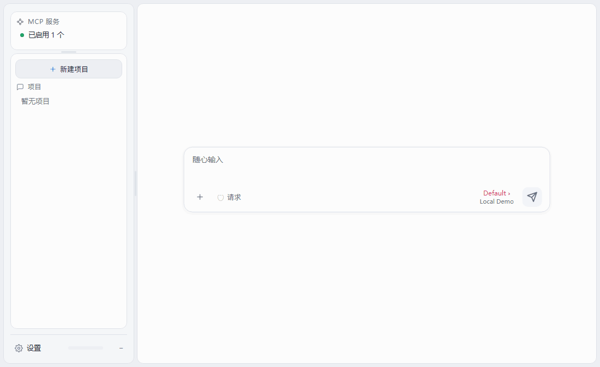

# CodeForge-Go

[简体中文详细文档](README_ZH.md) · [English documentation](README_EN.md) · [GitHub Releases](https://github.com/raine-x/CodeForge-GO/releases)

CodeForge-Go 是用 Go 写的自托管 AI 编码智能体。打开浏览器，选一个项目目录，就能让智能体阅读代码、修改文件和运行命令。

CodeForge-Go is a self-hosted AI coding agent written in Go. Open it in your browser, choose a project directory, and let the agent read code, edit files, and run commands.

[静态截图 · Still image](test/codeforge-demo.png)

## 亮点 · Highlights

| 简体中文 | English |
|---|---|
| **一个可执行文件，浏览器即界面。** 支持 Windows x64、Linux x64 和 Android ARM64（Termux）。 | **One executable with a browser UI.** Runs on Windows x64, Linux x64, and Android ARM64 with Termux. |
| **可审批、可回滚。** 按策略审批工具操作，通过文件检查点回滚改动。 | **Approve and roll back changes.** Tool actions follow approval policies, and file checkpoints let you undo edits. |
| **多模型与多会话。** 支持 OpenAI 兼容接口与 Anthropic，提供会话续跑、并行子智能体，以及 MCP 插件接入。 | **Multiple providers and sessions.** Supports OpenAI-compatible and Anthropic APIs, resumable sessions, parallel subagents, and MCP plugins. |
