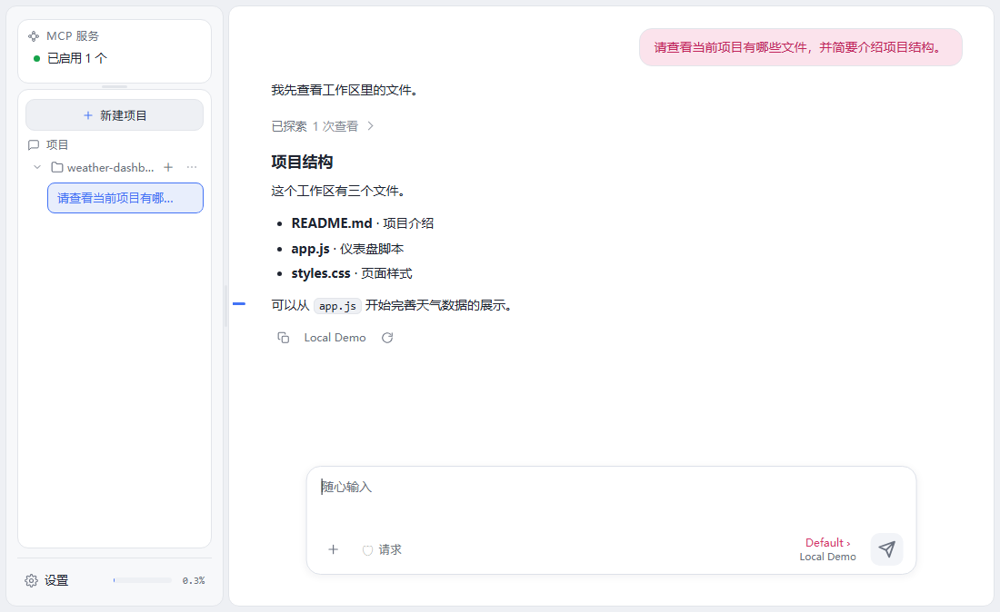

# CodeForge-Go · English documentation

For Android, use [CodeForge Mobile](https://github.com/raine-x/codeforge-mobile).

**Chat with an AI coding agent in your browser. It reads, writes and runs commands inside your project directory.**

Single static binary · Zero runtime dependencies · Windows / Linux

[Project overview](README.md) · [简体中文详细文档](README_ZH.md)

## Contents

- [Features](#features)
- [Quick start](#quick-start)
- [Configuration and deployment](#configuration-and-deployment)
- [Architecture and development](#architecture-and-development)
- [License](#license)

## Screenshots



[Light theme](test/cf-ui-light-theme.png) · [Appearance settings](test/cf-ui-settings-dark.png)

---

## Features

### Conversation & execution

- **Browser is the UI** — the same binary runs on a desktop or a headless server; no graphical environment needed
- **Built-in tools** — file read/write/edit/delete, directory listing, search, `run_command`, todo list, memory, skill creation, web fetch & search, subagent delegation, goal verification, tool-result read-back
- **Resume after interruption** — an interrupted turn is preserved; retry, edit-and-resend, or roll back the files along with it
- **Steer mid-run** — inject an instruction while the agent is working; it merges at the next step boundary

### Model access

- **Multiple providers** — OpenAI-compatible and Anthropic protocols
- **Model & provider libraries** — manage model entries and connection info from the UI; multiple models coexist
- **Multimodal** — image and video pass-through with tri-state capability declaration (unknown / supported / unsupported); upstream rejection rolls back the history automatically
- **Context-window probing** — measures the upstream's real accepted limit (1M down to 8K), not a hand-filled value in the model library
- **Rate limiting** — client-side RPM sliding window (slots requests before sending, never hits the wall) plus separate backoff for upstream 429s
- **Thinking level** — reasoning parameters built dynamically per upstream tier

### Concurrent sessions

- **Isolated per session** — separate run slots, undo stacks and read registries; no interference
- **Stable session switching** — switching a session follows its bound workspace
- **Project grouping** — the sidebar groups all sessions by workspace

### Subagents

- **Parallel delegation** — `delegate_subagents` splits work across multiple subagents, progress streams back live
- **Narrowed permissions** — write, delete and memory can be disabled individually; caps enforced in three places (Agent / scheduler / tool schema)
- **Independent, non-bypassable fence** — subagent scope checks apply on their own; even a human approval cannot punch through
- **Usage merged** — subagent tokens roll up into the parent session

### Goal mode

- **Mandatory verification** — the run must pass `goal_verify` before it can finish; failing means it keeps working instead of silently passing

### File safety

- **Workspace fence** — paths must stay inside the workspace; a symlink pointing outside is caught by resolving upwards link by link
- **Read before write** — files you never read cannot be overwritten from memory; if the file changed externally after reading, the fingerprint check refuses the write
- **CAS writes** — "read current → compare fingerprint → write" happens inside one per-path lock, so concurrent writes never silently overwrite each other
- **Atomic landing** — temp file in the same directory plus rename; a process killed mid-write leaves no half file
- **Byte-level undo** — snapshot before write, bucketed per session, restorable byte for byte
- **Checkpoint rollback** — roll back to any step, keyed by (session, step, path)

### Approval & policy

- **Three tiers** — Allow / Ask / Deny, switchable at runtime
- **Human-in-the-loop** — an `Ask` decision suspends the operation; approval timeout is separate from tool-execution timeout
- **Dangerous-command blacklist** — `rm -rf /` and friends are denied outright; highest priority, not overridable by rules
- **Full audit trail** — every tool call is written to an audit log (JSONL, rotates past 1 MiB, keeps 3 copies)
- **Capability surface** — hide selected tools from the model; hiding and forbidding are deliberately separate concerns

### Context

- **Online calibration** — no tokenizer dependency; the coefficient is derived from the real usage the upstream reports (only scaled up, never down — better to compress early)
- **Compression state persisted** — summary cursor and calibration factor survive restarts, so the "first request always overflows" trap doesn't repeat
- **Compression never loses history** — the full conversation is always retained; compression only changes the view sent to the model
- **Large results offloaded** — tool output over 8 KiB spills to disk as a reference (2 KiB preview stays in context); the model reads it back in chunks via `tool_result_read`
- **Usage visualisation** — a progress bar in the bottom bar shows live occupancy, with a manual compress trigger

### Interface

- **Hand-written single-file frontend** — no npm, no build step, embedded into the binary via `go:embed`
- **Dark/light themes + custom background** — background image, blur and brightness adjustable
- **Liquid glass toggle** — available in settings
- **Mobile layout** — sidebar becomes a drawer on narrow screens, settings scroll horizontally, visible height measured with `visualViewport`
- **Built-in picker** — a browser-style directory picker when no native dialog exists

### Extensibility

- **MCP plugins** — stdio / HTTP / SSE transports, adapted into standard tools
- **WASM plugins** — run WASM plugins through wazero
- **Skill system** — `<workspace>/.codeforge/skills/<name>/SKILL.md` with frontmatter

### Deployment

- **Single static binary** — `CGO_ENABLED=0`, with the browser UI embedded in the executable
- **Release builds** — Windows x64 / Linux amd64
- **Zero runtime dependencies** — 4 direct dependencies: WebSocket · WASM · YAML · system-call wrappers
- **Pure-Go SQLite** — `modernc.org/sqlite`, no C compiler needed, so static builds are never blocked
- **Access token** — a random token is generated when listening on a non-loopback address, delivered via HttpOnly cookie, validated by both API and WebSocket

---

## Quick start

### Download

Choose the executable for your platform from [GitHub Releases](https://github.com/raine-x/CodeForge-GO/releases). The available download is marked as a preview.

| Platform | Asset |
|---|---|
| Windows x64 | `codeforge-windows-amd64.exe` |
| Linux x64 | `codeforge-linux-amd64` |

Run the executable from a terminal. On Linux, grant execute permission with `chmod +x <asset>` and run `./<asset> -no-open`.

### Build from source

Use Go 1.25 or later. Clone the repository and run the following from its root.

```bash
git clone https://github.com/raine-x/CodeForge-GO.git
cd CodeForge-GO
```

**Windows (PowerShell)**

```powershell
$env:CGO_ENABLED = '0'
go build -trimpath -ldflags '-s -w' -o bin/codeforge.exe ./cmd/agent
.\bin\codeforge.exe -no-open
```

**Linux**

```bash
CGO_ENABLED=0 go build -trimpath -ldflags "-s -w" -o bin/codeforge ./cmd/agent
./bin/codeforge -no-open
```

Open <http://127.0.0.1:8420>, choose a workspace, and configure a provider and model in Settings. Keep your API key in an environment variable such as `CODEFORGE_API_KEY`.

## Configuration and deployment

- Run with `-config <directory>` to load settings from another directory and `-workdir <directory>` to set the initial workspace. See [default settings](config/default.yaml) and the [local override template](config/local.yaml.example).
- Use the model settings page to configure the provider, model, and endpoint. For a provider-specific key, select its environment variable in Settings or reference it as `${VARIABLE_NAME}` in YAML.
- Use `-no-open` on a headless host. By default the service listens on `127.0.0.1:8420`. You can reach it from another machine using an SSH tunnel with `ssh -L 8420:127.0.0.1:8420 user@server`.
- To resume the most recent session for a workspace, use `-continue`. Use `-resume <id-or-title>` to select a specific session.

## Architecture and development

The browser connects to the Go server over HTTP and WebSocket. The server forwards conversation turns to the agent. The agent streams requests to model providers and sends tool calls through an executor that checks policy, handles approvals, and records audit events. SQLite stores session data and file checkpoints.

| Area | Implementation |
|---|---|
| Entry point | [cmd/agent](cmd/agent) starts the service and handles command-line options. |
| Browser UI | [web/dist](web/dist) contains the UI sources, which [web/embed.go](web/embed.go) embeds in the binary. |
| Server and orchestration | [pkg/server](pkg/server) serves HTTP and WebSocket. [pkg/agent](pkg/agent) manages conversation turns, context, and subagents. |
| Model adapters | [pkg/llm](pkg/llm) handles provider protocols, streaming, and rate limits. |
| Tool execution | [pkg/tools](pkg/tools) dispatches calls. [pkg/security](pkg/security) evaluates policies, and [pkg/backend](pkg/backend) provides filesystem and process operations. |
| Persistence and configuration | [pkg/store](pkg/store) implements SQLite persistence. [config](config) defines and loads application settings. |

From the repository root, run `go vet ./...` and `go test ./...`. Run `make test-web` for the three Node.js frontend test suites. See the [release guide](docs/releasing.md) for the platform build matrix and attachment checks, and [AGENTS.md](AGENTS.md) for repository development conventions.

## License

**GPL-3.0 with additional restrictions (no commercial use; commercial use requires written permission).**

Non-standard SPDX license — see section 2 and section 6 of [LICENSE](LICENSE).
