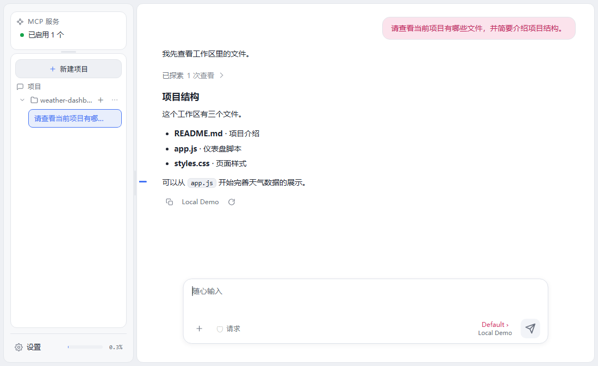
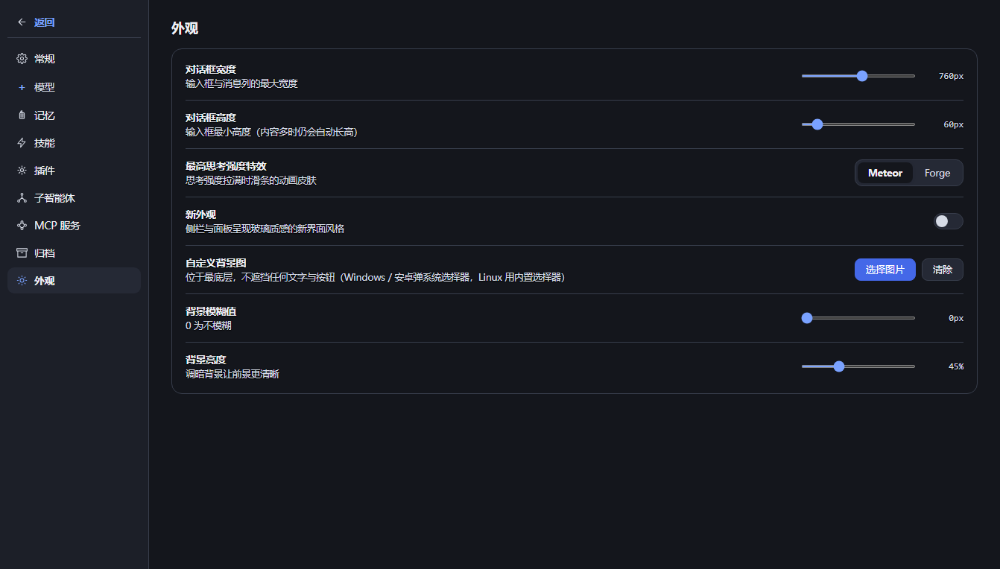

# CodeForge-Go · 中文详细版

Android 用户请使用 [CodeForge Mobile](https://github.com/raine-x/codeforge-mobile)。

**在浏览器里和 AI 编码智能体对话。它在你的项目目录里读写文件、跑命令、调模型。**

单文件静态二进制 · 零运行时依赖 · Windows / Linux

[English](README_EN.md) | [项目首页](README.md)

---

## 目录

- [界面截图](#界面截图)
- [特性详解](#特性详解)
- [快速开始](#快速开始)
- [命令行参数](#命令行参数)
- [各平台启动](#各平台启动)
- [配置与密钥](#配置与密钥)
- [安全模型](#安全模型)
- [子智能体](#子智能体)
- [目标模式](#目标模式)
- [打断之后怎么接着跑](#打断之后怎么接着跑)
- [测试](#测试)
- [系统架构](#系统架构)
- [目录结构](#目录结构)
- [技术选型](#技术选型)

---

## 界面截图





## 特性详解

### 浏览器 UI = 无 GUI 环境可用

界面是一个网页，不依赖 X11/Wayland/桌面环境。同一份二进制在这些场景下都能用：

| 场景 | 怎么用 |
|---|---|
| **无 GUI 服务器** | SSH 上去启动，`-no-open` 免得它尝试拉浏览器；用本地浏览器访问 `http://<服务器地址>:8420` |
| **容器 / NAS / 树莓派** | 同服务器，暴露端口即可 |
| **Windows / 桌面 Linux** | 启动后自动打开浏览器 |

没有 Electron、没有前端构建步骤、没有 npm 依赖 —— `web/dist/` 里的文件是手写源码，`go:embed` 直接打进二进制。

默认只监听 `127.0.0.1`（本机回环），不对外暴露。需要从别的机器访问时改 `config/default.yaml`：

```yaml
server:
  host: "0.0.0.0"   # 监听所有网卡
  port: 8420
```

> ⚠️ 改成 `0.0.0.0` 等于把 Agent 的读写权限暴露到网络上。服务自带访问令牌做防护，但**务必只在你信任的网络里这么做**，且不要直接暴露到公网。

### 低内存占用

启动后常驻约 25 MB（Windows amd64 空载实测 Working Set）。几个关键设计：

- **软内存上限**：`GOMEMLIMIT` 按物理内存的 25% 自动设定，夹逼在 256 MiB ~ 2 GiB。超限时 Go GC 更积极，而不是等系统 OOM。可用 `CODEFORGE_GOMEMLIMIT` 覆盖。
- **上下文主动压缩**：每轮请求前检查 token 占用，超预算先压缩历史再发送。
- **工具结果限幅**：大结果由工具分页，Executor 只做兜底截断，且截断产出仍是合法 JSON。
- **撤销栈有字节预算**：单条超限落盘、总量有上限、丢弃时明确告知。

### 多会话并发

同一个项目里可以同时跑多个会话，互不干扰：

- **运行表按会话分槽**：每个会话各有自己的取消句柄，发消息和打断只作用于本会话。
- **撤销栈按会话分桶**：A 的撤销撤不到 B 的写入。
- **阅读登记按会话隔离**：A 读过的文件不会让 B 获得「凭记忆改写」的资格。
- **运行中转向只对当前会话生效**。
- **不跨会话打断**：在 B 按打断不会停掉后台正在跑的 A。

> **当前的边界**：并发在**同一工作区内**完全成立。跨工作区并发还不支持 —— 工作区是进程级的，切它会改掉正在跑的那些会话所看到的工作区，所以有任务在跑时跨项目切换会被挡并给出提示。

### 跨平台静态编译

`CGO_ENABLED=0` 静态编译，无外部运行时依赖：

| 目标 | 产物 |
|---|---|
| Windows x64 | `bin/codeforge-windows-amd64.exe` |
| Linux x86_64 / arm64 | `bin/codeforge-linux-amd64` |

SQLite 用 `modernc.org/sqlite`（纯 Go 实现），所以不需要 C 编译器。

### 内置工具

文件：`read_file` `write_file` `edit_file` `delete_file` `list_dir` `search_files` `find_files`
命令：`run_command`
协作：`delegate_subagents`（多智能体） `goal_verify`（目标模式强约束校验）
其它：`todo_write` `save_memory` `create_skill` `web_fetch` `web_search` `tool_result_read`

### 文件操作的安全约束

这几条是硬性的，改不动：

- **先读后写**：没读过的文件不允许凭记忆改写。读取之后若被外部改动，指纹比对会发现并拒绝。
- **CAS 写入**：「读当前 → 比对 → 写」在同一把按路径的锁内完成，并发写不会静默互相覆盖。
- **原子落盘**：同目录临时文件 + rename。进程写一半被杀不会留半截文件。
- **工作区围栏**：路径必须落在工作区内。「区内软链指向区外、且目标尚不存在」这类绕过会被逐级向上解析挡住。
- **原子级撤销**：写前快照，按会话分桶，可逐字节还原。

### 人工审批（HITL）

策略判定为 `Ask` 的操作会挂起，在界面上等你的决定。审批有独立超时（默认 15 分钟），与工具执行超时分开 —— 「用户拒绝」和「没人管」在界面上的说法不同。

### 模型管理与上下文

- 在设置里管理供应商、模型和连接配置。支持 OpenAI 兼容接口与 Anthropic 协议。可为每个模型配置请求频率（RPM）及图像、视频能力。
- 图片和视频是否可发送取决于模型与接口能力。缺少图片能力时会提示并中止本轮。缺少视频能力时会提示并跳过视频。
- 对话过长时会压缩发给模型的上下文，完整对话仍可回看。较大的工具输出保存在本地，智能体可通过 `tool_result_read` 分段读取。

### 其它

- **断点续跑**：任务被打断后保留未完成轮次，可从断点重试或编辑重发。
- **系统通知**：任务完成时按需发系统通知，带可见性判断与节流。
- **子智能体**：把任务派给多个子智能体并行处理，进度实时回传。
- **目标模式**：完成前必须通过 `goal_verify` 校验，不通过就继续。
- **插件机制**：MCP / 远程能力可适配成标准工具接入。

---

## 快速开始

### 1. 构建

也可以从 [GitHub Releases](https://github.com/raine-x/CodeForge-GO/releases) 下载预览版。源码构建需要 Go 1.25 或更新版本。

Windows PowerShell 在仓库根目录执行：

```powershell
$env:CGO_ENABLED = '0'
go build -trimpath -ldflags '-s -w' -o bin/codeforge.exe ./cmd/agent
```

以下命令适用于 Bash：
```bash
# Linux 本机构建
CGO_ENABLED=0 go build -trimpath -ldflags "-s -w" -o bin/codeforge ./cmd/agent

# 交叉编译发布产物
CGO_ENABLED=0 GOOS=windows GOARCH=amd64 go build -trimpath -ldflags "-s -w" -o bin/codeforge-windows-amd64.exe ./cmd/agent
CGO_ENABLED=0 GOOS=linux   GOARCH=amd64 go build -trimpath -ldflags "-s -w" -o bin/codeforge-linux-amd64 ./cmd/agent
```

有 Makefile 的话 `make build` / `make all-platforms` 一次跑完。

### 2. 配置 API Key

**密钥只从系统环境变量读**，不读任何密钥文件。这样密钥不会躺在项目目录里被同步盘、备份脚本随手带走。

**Linux / macOS**（写进 shell 配置持久生效）：

```bash
echo 'export CODEFORGE_API_KEY=sk-...' >> ~/.bashrc
source ~/.bashrc
```

**Windows**（`setx` 对新终端生效）：

```powershell
setx CODEFORGE_API_KEY "sk-..."
```

### 配置文件里引用环境变量

不想每次都 export？**在 YAML 里写 `${变量名}`**，值在加载时从环境取：

```yaml
# config/providers.yaml
providers:
  - id: my-gateway
    name: 某网关
    base_url: ${GATEWAY_URL}/v1     # ← 变量引用，文件里没有地址
    protocol: openai
    key_source: plain
    key_value: ${GATEWAY_KEY}       # ← 变量引用，文件里没有密钥
```

`config/models.yaml` 与 `config/local.yaml` 同样支持：

```yaml
# config/local.yaml
llm:
  api_key: ${MY_KEY}
  base_url: ${MY_BASE_URL}
  model: gpt-4o
```

**支持 `${NAME}` 与 `$NAME` 两种写法**；`\${NAME}` 取字面量。展开只发生在内存里，**不会改写文件**。

**变量没设时怎么办**：按空处理，并在启动日志里点名：

```
WARN  供应商库 config/providers.yaml 引用了未设置的环境变量：GATEWAY_KEY（这些值已按空处理；…）
```

这样配了十项错一项时，其余九项照样能用；而且日志会直接告诉你少了哪个变量 —— 否则症状是「明明配了却连不上」，错误信息指向 401，完全看不出是变量没设。

### 变量名优先级

若没在 YAML 里写 `${...}`，程序按 `config/config.go` 的 `applyEnvFallback` 依次尝试：

| 变量名 | 说明 |
|---|---|
| `CODEFORGE_API_KEY` | **推荐**，所有 provider 通用，优先级最高 |
| `ANTHROPIC_API_KEY` | `provider: anthropic` 时的次选 |
| `OPENAI_API_KEY` | `provider: openai` / `custom` 时的次选 |
| `LLM_API_KEY` | 最后一档兜底（旧代码的默认名） |

> 如果 `config/local.yaml` 里显式写了 `llm.api_key`（含 `${…}` 展开后的值），**它优先于上面这条链**。

**非敏感配置**（模型名、协议等）直接在 YAML 里写，或用界面上的「设置」页改 —— 那会写进 `config/models.yaml` 与 `config/providers.yaml`（两个文件都在 `.gitignore` 里）。

### 3. 启动

```bash
# 方式一：启动器（内部自动切到项目根目录，与当前目录无关）
./cf.cmd          # Windows
./cf              # Linux

# 方式二：直接运行 —— 两个路径都给绝对值，从哪启动都一样
./bin/codeforge -config /path/to/project/config -workdir /path/to/project

# 方式三：Makefile（在仓库根目录构建并启动）
make run

# 无 GUI 服务器
./bin/codeforge -no-open -config /srv/myproject/config -workdir /srv/myproject
```

### 4. 选择工作区

启动后在界面里选一个工作区（一个项目目录），或者启动时用 `-workdir` 指定。

### 5. 开始对话

在浏览器里直接提问。Agent 会在工作区里读写文件、跑命令。

---

## 命令行参数

```
codeforge [start]  [-config 目录] [-workdir 目录] [-no-open]   启动服务（默认）
codeforge stop     [-config 目录]                              停止运行中的服务
codeforge restart  [-config 目录] [-workdir 目录] [-no-open]   重启服务
```

会话续跑（回到上次中断的地方继续）：

```
codeforge -continue                 打开上次那个会话
codeforge -resume last              同上
codeforge -resume <会话ID前缀>       打开指定会话（ID / ID 前缀 / 标题均可）
codeforge -continue -workdir <目录>  先切到该工作区，再回到它上次的会话
```

| 选项 | 含义 |
|---|---|
| `-config DIR` | 配置目录，默认 `config` |
| `-workdir DIR` | Agent 工作目录（必须绝对路径），默认当前目录 |
| `-no-open` | 不自动打开浏览器 |
| `-continue` | 启动后回到该工作区最近更新的一条会话 |
| `-resume <ID>` | 启动后回到指定会话：会话 ID / ID 前缀 / 会话标题 / `last` |

若 `-resume` 的会话属于另一个工作区，会先切工作区 —— 「拿着 A 项目的对话、让模型下一步去改 B 项目的文件」正是要避免的失败模式。

与已在运行的实例共存时：仅把浏览器指到目标会话，不重启服务。

---

## 各平台启动

### 三条通用规则

1. **`-config` 与 `-workdir` 都给绝对路径**。给绝对值之后从哪个目录启动都一样，不必切 CWD（也可以先切到仓库根目录，再用 `make run`）。
2. **工作区必须是绝对路径** —— 相对路径没有意义（工作区没法相对自己），放任它会被按进程当前目录解析，换个启动方式工作区就变了。
3. **配置的工作区不存在或不是目录**，按未选择工作区处理，不会静默设成工作目录。

另外：**没有图形环境时加 `-no-open`**（无 GUI 服务器、容器内都需要）。

### 无 GUI 服务器（Linux / BSD / 容器 / NAS）

这是这个程序被设计成网页界面的主要理由。

```bash
# 上传到服务器
scp bin/codeforge-linux-amd64 user@server:/usr/local/bin/codeforge

# 启动（-no-open 免得它尝试拉浏览器；两个路径都给绝对值，从哪启动都一样）
./codeforge -no-open -config /srv/myproject/config -workdir /srv/myproject
```

然后：

1. 默认只监听 `127.0.0.1`，此时只有服务器本机能访问 —— 用 SSH 端口转发最省事：

   ```bash
   # 在你自己的机器上执行
   ssh -L 8420:127.0.0.1:8420 user@server
   ```

   然后浏览器开 <http://127.0.0.1:8420>。

2. 需要从别的机器直接访问时，把 `config/default.yaml` 的 `server.host` 改成 `0.0.0.0`，并确认防火墙放行 8420 端口。服务启动时会生成随机访问令牌并通过 HttpOnly Cookie 下发，API 与 WebSocket 都会校验它，所以没有匿名访问。

   > ⚠️ 改 `0.0.0.0` 等于把 Agent 的文件读写能力暴露到网络上。令牌能挡住未授权访问，但请**只在你信任的网络里这么做**，并优先用 SSH 端口转发。

后台常驻可以用 systemd：

```ini
[Unit]
Description=CodeForge
After=network.target

[Service]
ExecStart=/usr/local/bin/codeforge -no-open -config /srv/myproject/config -workdir /srv/myproject
EnvironmentFile=/etc/codeforge/env
Restart=on-failure

[Install]
WantedBy=multi-user.target
```

用 systemd 时**必须**用 `EnvironmentFile=` 把密钥传进去 —— 服务没有 TTY，读不到你在交互式 shell 里 `export` 的东西：

```
# /etc/codeforge/env
CODEFORGE_API_KEY=sk-...
```

```bash
chmod 600 /etc/codeforge/env && chown root:root /etc/codeforge/env
```

放在 `/etc` 而不是项目目录，是为了让它跟着「配置」走而不是跟着「代码」走。

`stop` / `restart` 子命令同样可用。

### Windows x64

双击 `cf.cmd`，或：

```powershell
.\bin\codeforge.exe -config config
```

### Linux x86_64

```bash
chmod +x bin/codeforge-linux-amd64
./bin/codeforge-linux-amd64 -config /path/to/project/config -workdir /path/to/project
```

### 最小化部署

只需要二进制 + 一个配置目录：

```
/usr/local/bin/codeforge          # 16 MB，单文件
/etc/codeforge/env                # 密钥（chmod 600）
/srv/myproject/config/            # 配置目录
```

---

## 配置与密钥

### 分层与写入者

| 文件 | 谁写 | 说明 |
|---|---|---|
| `config/default.yaml` | 人工维护 | 随仓库提供 |
| `config/models.yaml` | 界面「设置」 | 模型库。字段可写 `${VAR}` 引用环境变量 |
| `config/providers.yaml` | 界面「设置」 | 供应商库。字段可写 `${VAR}` 引用环境变量 |
| `config/local.yaml` | 人工编辑 | 本地覆盖，**禁止提交** |
| **系统环境变量** | 人工设置 | **密钥的落点**：`CODEFORGE_API_KEY`，或 YAML 里 `${...}` 引用它 |
| `.codeforge/` | 程序 | 会话、审计日志、撤销副本、记忆 |

### 密钥在哪

**首选：系统环境变量。** 程序不读密钥文件 —— 文件会躺在项目目录里被同步盘、备份脚本、`docker cp` 随手带走，而环境变量不会。

三种写法，效果相同：

```yaml
# 1) 显式引用（推荐，配置文件里自解释）
key_value: ${MY_GATEWAY_KEY}

# 2) 只记变量名，请求时才去读（界面上的「环境变量」选项）
key_source: env
key_name: MY_GATEWAY_KEY

# 3) 什么都不配，走内置优先级链
#    CODEFORGE_API_KEY → 厂商专用名 → LLM_API_KEY
```

**次选：界面「设置」页直接填。** 方便但会写成明文，存在 `config/providers.yaml` 里。

**兜底：`config/local.yaml` 的 `llm.api_key`。** 优先级最高 —— 写了就压过上面两者。

三者可以并存。想收敛到一处，把另两处清空即可。

### 密钥是硬约束

`config/models.yaml`、`config/providers.yaml`、`config/local.yaml` **全部在 `.gitignore` 里**，
且是按**文件名通配**（`*models.yaml`）而非路径 —— 配置目录改名也挡得住。

`.gitignore` 还会按**文件名**忽略含 `secret` / `credential` / `api_key` / `apikey` 的文件 ——
代价是正常源码里带这些词的文件也会被静默忽略。写代码时避开这些词（凭据解析那套叫 `config/resolve_llm.go`）。

---

## 安全模型

三级策略：**Allow / Ask / Deny**。

- 规则在 `config/default.yaml` 的 `security.rules` 里，有序匹配。
- **内置危险命令黑名单优先级最高**：`rm -rf /` 之类直接 Deny，规则表改不动。
- 条件解析失败按**拒绝**处理，不是跳过。
- 命中 `Ask` 的操作走人工审批，审批渠道在界面上。
- 每次工具调用都写审计日志（JSONL，超 1 MiB 轮转，保留 3 份）。

`agent.hidden_tools`（控制发给 LLM 的工具表）与 `security.Policy`（控制是否放行）是**刻意分离**的：隐藏不等于禁止。不要合并成一个开关。

### 权限模式

| 模式 | 语义 |
|---|---|
| `readonly` | 只读工具放行，其余一律拒绝 |
| `ask` | 默认人工审批（**默认模式**） |
| `auto` | 默认放行（黑名单仍生效） |

可在界面「权限控制」里切换，运行期热切换。

---

## 子智能体

`delegate_subagents` 把任务派给多个子智能体并行处理。子智能体有独立的策略上限（三处落点同步：Agent / 调度器 / 工具 schema）。

子智能体的操作**全部进审计日志**（历史上曾漏配，导致子智能体操作不留痕）。

权限收窄用工具白名单实现：禁写就是不注册 `write_file`，模型看不到该工具。
子智能体工具集**永不包含** `run_command`、插件工具、`create_skill`、`delegate_subagents`（防递归委派）。

子智能体的围栏**不可被人工审批穿透** —— 越界检查独立生效。

---

## 目标模式

`goal_verify` 在任务完成前做强制校验。不通过就继续做，不会静默放过。审查者的 audit 传真 logger。

---

## 打断之后怎么接着跑

任务被打断时保留未完成轮次：

- 界面上的重试圆环：点击从原提问重新开始（保留已产生的上下文）。
- 编辑重发：改写某条历史提问后重发，服务端截断到那条消息并重跑。
- 文件回滚：编辑重发时可连带回滚该消息之后的文件改动。

断点状态在检查点面板里可见。

---

## 测试

### Go 单元 / 集成测试

```bash
go test ./...
```

e2e 默认 Skip，需 `CODEFORGE_E2E=1` 且配置真实 Key。

### 前端渲染器测试（Node，零依赖）

```bash
node web/test/render_md.test.js
node web/test/attachments.test.js
node web/test/picker.test.js
```

改 `ui.js` 后**必须**跑这三个。测试里有对源码文本的断言，改函数名或结构要同步。

### 提交前自检

```bash
gofmt -l .
go vet ./...
go test ./...
node web/test/render_md.test.js
node web/test/attachments.test.js
node web/test/picker.test.js
# 发布版编译
CGO_ENABLED=0 GOOS=windows GOARCH=amd64 go build -trimpath -ldflags "-s -w" -o bin/ ./cmd/agent
CGO_ENABLED=0 GOOS=linux   GOARCH=amd64 go build -trimpath -ldflags "-s -w" -o bin/ ./cmd/agent
```

`go test -race` 需要 C 编译器（`-race` 依赖 cgo）。没装 gcc 时不可用 —— 这也是为什么并发相关的护栏主要是**结构性断言**（解析源码确认形状）而不是竞态检测。

有 Makefile 的话 `make test` / `make test-web` 可以一次跑完。

---

## 系统架构

浏览器通过 HTTP 和 WebSocket 连接 Go 服务。服务端把对话交给智能体，智能体通过模型适配层发起流式请求，并经统一执行器调用工具。执行器负责策略、审批和审计。SQLite 保存会话和文件检查点。

| 组件 | 职责 |
|---|---|
| [cmd/agent](cmd/agent) | 命令行入口与服务启动 |
| [web/dist](web/dist) · [web/embed.go](web/embed.go) | 浏览器界面及静态资源嵌入 |
| [pkg/server](pkg/server) · [pkg/agent](pkg/agent) | HTTP 和 WebSocket、对话编排、上下文与子智能体 |
| [pkg/llm](pkg/llm) | 模型协议、流式响应与限流 |
| [pkg/tools](pkg/tools) · [pkg/security](pkg/security) · [pkg/backend](pkg/backend) | 工具执行、策略判定、文件及进程操作 |
| [pkg/store](pkg/store) · [config](config) | SQLite 持久化与应用配置 |

开发约定见 [AGENTS.md](AGENTS.md)。版本核对、Windows 和 Linux 构建及附件校验见[发布流程](docs/releasing.md)。

## 目录结构

```
cmd/agent/          入口：flag 解析、进程生命周期、装配
pkg/agent/          编排：ReAct 循环、历史、压缩、检查点
pkg/tools/          工具接口、注册、执行器（含策略判定与审批）
pkg/tools/builtin/  内置工具实现 + 会话守卫（围栏/指纹/撤销栈）
pkg/tools/plugins/  插件驱动（MCP / 远程能力适配成工具）
pkg/backend/        执行环境抽象（纯 IO 后端，本机实现）
pkg/security/       策略判定与审计日志
pkg/server/         HTTP + WebSocket 服务
pkg/llm/            LLM 适配器（SSE 流式）
pkg/store/          SQLite 持久化
pkg/platform/       平台差异（shell、进程组、路径）
pkg/errs/           错误分类
pkg/logx/           结构化日志
web/dist/           前端（手写单文件，无构建步骤）
config/             配置（见「配置与密钥」）
```

---

## 技术选型

| 方面 | 选择 | 理由 |
|---|---|---|
| 语言 | Go | 单文件静态编译，跨平台，内存可控 |
| 存储 | SQLite（`modernc.org/sqlite`，纯 Go） | 零外部依赖，`CGO_ENABLED=0` 也能静态编译 |
| 前端 | 手写单文件 JS | 无构建步骤 = 无 node_modules、无版本漂移 |
| 依赖 | 极少 | 静态编译与产物体积是产品目标 |

---

## 许可

**GPL-3.0 + 附加限制（禁止商业使用，商业使用须书面授权）。**

非标准 SPDX 许可，详见 [LICENSE](LICENSE) 第 2 条与第 6 条。
